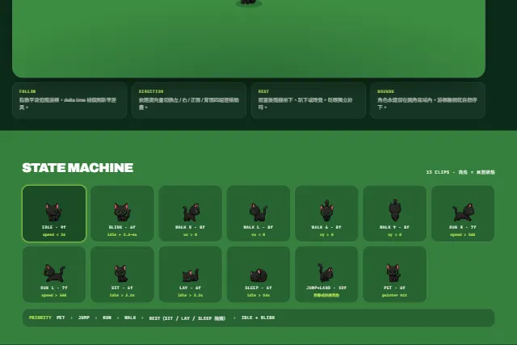

# KURO

**English** · [繁體中文](./README.zh-TW.md)

> A **cursor pet playground** — a little black cat (and friends) that follows your pointer with hand-drawn sprite states

<p align="center">
  
</p>

<p align="center">
  <a href="https://github.com/ReiKama414/kuro">Star</a>
  ·
  <a href="https://reikama414.vercel.app/">Portfolio</a>
  ·
  <a href="#quick-start">Quick start</a>
  ·
  <a href="#license--rights">License</a>
</p>

---

## Why

A small interactive demo for a cursor-following pet: smooth motion, facing, idle rest, blink, pet, and jump — all driven by sprite strips, not CSS nudges of a single still

## Highlights

- **Follow the pointer** — exponential smoothing with delta-time so speed stays consistent across refresh rates
- **Thirteen clips** — idle, blink, walk ×4, run ×2, sit, lay, sleep, jump, pet
- **Eleven characters** — cat (KURO), seal, raccoon, dachshund, hamster, panda, crow, spider, fox, jellyfish, squid
- **Playground HUD** — live state, speed, facing, and pet count
- **State machine board** — preview strips highlight the clip currently playing
- **Interactive collection** — filter animations, click to try a pose, or use H/J/Z to pet, jump and sleep
- **Focus mode** — 25/50-minute focus sessions and 5-minute breaks with pause, resume and reset
- **Everyday extras** — free roaming, pet scaling, grid toggle, PNG snapshots and remembered character selection

## Tech stack

| Area | Choice |
| --- | --- |
| App | React · Vite |
| Render | Canvas 2D sprite strips |
| Type / UI | Archivo · JetBrains Mono · Noto Sans TC (Google Fonts) |

## Quick start

Node.js 20+ recommended.

```bash
npm install
npm run dev
```

Open the local URL printed by Vite.

Production build:

```bash
npm run build
npm run preview
```

Static output lands in `dist/`. Sprite art is served from `/assets/sprites/…`.

Rebuild dog and hamster sprites with `python tools/slice-pets.py` (requires Pillow, numpy and scipy), then run `python tools/preview-pets.py` for frame contact sheets. Extraction preserves the original alpha; `assets/sprites/counts.json` supplies runtime frame counts. Overlapping dog movement poses are replaced with intact poses, mirrored for leftward motion, with holds preserving the original cycle timing.

The panda atlas was made with built-in imagegen and saved as `uploads/sheet-panda.png`; its full prompt is in `uploads/panda-prompt.txt`. Run `python tools/slice-panda.py` to rebuild all 13 panda clips.

Crow, spider and fox also use built-in imagegen artwork. Sources and prompts live in `uploads/sheet-{crow,spider,fox}.png` and `uploads/{crow,spider,fox}-prompt.txt`. Run `python tools/sprite_atlas.py crow spider fox` to rebuild their clips.

Jellyfish and squid use the same atlas pipeline, with swimming pulses and tucked resting poses. Source atlases and complete prompts are saved in `uploads/sheet-{jellyfish,squid}.png` and `uploads/{jellyfish,squid}-prompt.txt`. Rebuild with `python tools/sprite_atlas.py jellyfish squid`.

The character toolbar scrolls horizontally and reveals the selected pet automatically. Arrow keys switch pets; Home/End select the first/last pet.

Run `npm test` for animation timing, one-shot completion, refresh-rate consistency and jump direction. Run `npm run check:sprites` to validate every strip's frame counts, alpha, padding and fragments.

After legacy re-slicing, `python tools/repair-sprites.py` restores keyed-out cat eyes from the source and aligns seal ground anchors (also requires opencv-python). Intentional gaps between the cat's tail and torso are preserved.

## Controls

| Action | Result |
| --- | --- |
| Move pointer inside the stage | The pet follows |
| Click near the pet | Pet reaction |
| Double-click | Jump |
| Leave the stage | Motion settles; pet stays in bounds |
| Species pills | Switch character and strip set |
| Animation cards | Try a clip; moving the pointer resumes following |
| H / J / Z | Pet / jump / sleep |
| F / Esc | Enter / leave focus mode |
| Free roaming | Wander and rest when the pointer is away |
| Camera | Download a PNG with the character name |

## Project structure

| Path | Role |
| --- | --- |
| `src/Kuro.jsx` | Page, interaction controls and focus mode UI |
| `src/usePetEngine.js` | Canvas animation, following and interaction state |
| `src/useFocusTimer.js` | Focus timer based on actual elapsed time |
| `src/pets.js` | Character and animation definitions |
| `src/main.jsx` | React entry |
| `src/index.css` | Base styles and nav / CTA helpers |
| `assets/sprites/{species}/` | Per-clip PNG strips (`idle`, `walk_right`, …) |
| `assets/sprites/counts.json` | Frame counts per species |
| `uploads/` | Working reference sheets (not required at runtime) |

## Third-party notices

| Item | Notes |
| --- | --- |
| React · React DOM · Vite | Upstream licenses apply to those packages only |
| Archivo · JetBrains Mono · Noto Sans TC | Font licenses from their distributors |

Project code, branding (KURO), copy, and sprite / sheet assets in this repo remain under the project license below — package licenses do **not** re-license those assets.

## Links

| | |
| --- | --- |
| Repository | [kuro](https://github.com/ReiKama414/kuro) |
| Author | [ReiKama414](https://github.com/ReiKama414) |
| Portfolio | [Personal site](https://reikama414.vercel.app/) |
| License text | [LICENSE](./LICENSE) |

## License / rights

Copyright (c) ReiKama414. All rights reserved.

This project is provided for personal viewing and learning only. Without the copyright holder’s written consent, you may not use, copy, modify, distribute, or incorporate it into other projects (commercial or non-commercial).

- [GitHub](https://github.com/ReiKama414/kuro)
- [Personal site](https://reikama414.vercel.app/)
- [Full license text](./LICENSE)

---

<sub>KURO · Cursor pet demo · ReiKama414 · 2026</sub>
